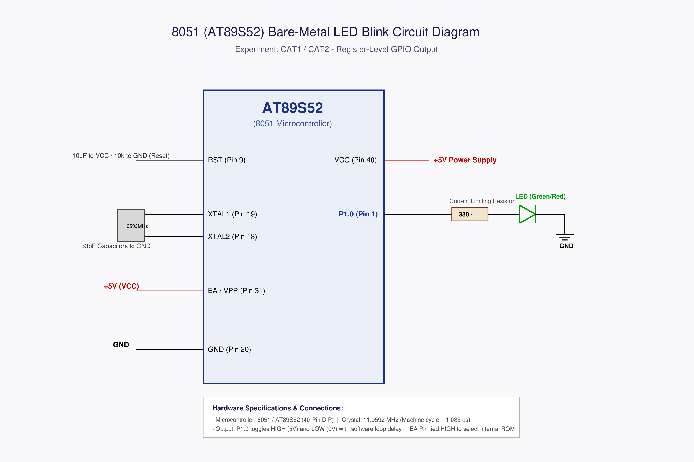

# EXPERIMENT DETAILS

**EXP:** CONTINUOUS ASSESMENT 1

**DATE:** 20/07/2026

**NAME OF EXP:** 8051 Development Board Tool Chain Setup

**HARDWARE SETUP / PLATFORM:** AT89S52 Microcontroller Development Board + Keil µVision C51

---

## TASK 1 : Bare-Metal LED Blink & Toolchain Verification

### 1. Circuit Diagram

The experiment demonstrates basic GPIO digital output interfacing using the 8051 (AT89S52) microcontroller.

- **Development Board:** AT89S52 Minimal System Board
- **Microcontroller IC:** Atmel AT89S52 (40-Pin DIP)
- **Clock Source:** 11.0592 MHz Crystal Oscillator with two 33 pF ceramic capacitors
- **Reset Circuit:** 10 µF electrolytic capacitor to VCC with 10 kΩ pull-down resistor
- **GPIO Pin:** Port 1 Pin 0 (P1.0) configured as digital output
- **Peripheral:** Standard 5mm LED with a 330 Ω current-limiting resistor connected to GND
- **Power Supply:** Regulated +5V DC

### 2. Core Logic / Pseudocode / Code Base

**Working Principle:**

The 8051 architecture provides bi-directional I/O ports. Port 1 pins feature internal pull-up resistors and can source/sink current. By alternating bit P1.0 between logic HIGH (5V) and logic LOW (0V), current flows through the external LED and current-limiting resistor, producing a regular visual blink pattern. Timing intervals are provided through calibrated nested software delay iterations.

**Pseudocode:**

1. Include the register definition header `reg51.h`.
2. Define `BLINK_LED` mapped to pin P1.0 using the `sbit` keyword.
3. Construct a delay function taking a millisecond parameter using nested decrement loops.
4. In the `main()` function loop:
   a. Drive `BLINK_LED = 1` to turn ON the LED.
   b. Call `delay_cycles(500)` to hold state for 500 ms.
   c. Drive `BLINK_LED = 0` to turn OFF the LED.
   d. Call `delay_cycles(500)` to hold state for 500 ms.
5. Repeat execution indefinitely in an infinite `while(1)` superloop.

**Code Base:**

- Header: `reg51.h` provides direct memory-mapped SFR declarations.
- Pin Mapping: `sbit BLINK_LED = P1^0;` maps bit 0 of Port 1.
- Loop Delay: `delay_cycles(unsigned int count)` computes $120 \times 1.085\,\mu\text{s} \approx 1\,\text{ms}$ per iteration at 11.0592 MHz.

### 3. Inference

The Keil µVision C51 cross-compiler toolchain, project build system, and hex generator were successfully brought up and verified. The generated firmware executes directly on the AT89S52 bare-metal target, confirming correct clock oscillation, reset behavior, and GPIO bit-addressable register manipulation.
