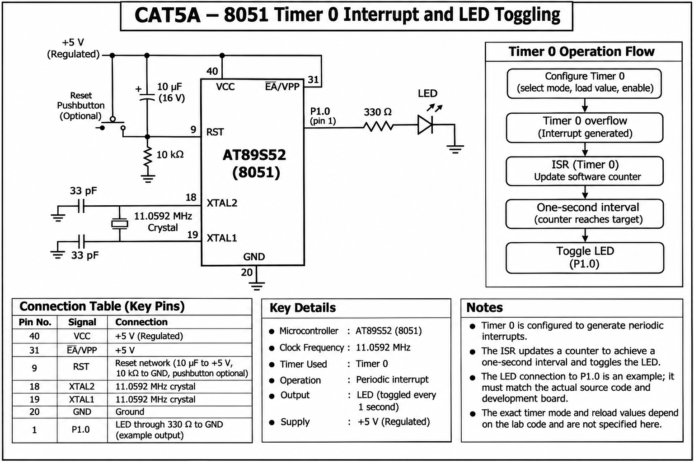

# EXPERIMENT DETAILS

**EXP:** CONTINUOUS ASSESSMENT 5 (CAT5)

**DATE:** 10/08/2026

**NAME OF EXP:** Timer and Interrupt Programming

**HARDWARE SETUP / PLATFORM:** AT89S52 (11.0592 MHz) + Keil C51 µVision

---

## TASK 5A : 1-Second Timer0 Hardware Interrupt Generator

### 1. Circuit Diagram

The circuit connects an indicator LED via a 330 Ω resistor to Port 1 Pin 0 (P1.0) of the AT89S52.

- **Microcontroller:** AT89S52
- **Clock Source:** 11.0592 MHz Crystal
- **Output Pin:** P1.0
- **Peripheral:** 5mm Green LED with 330 Ω series resistor
- **Power Supply:** +5V DC

### 2. Core Logic / Pseudocode / Code Base

**Working Principle:**

Timer 0 is configured in 16-bit Mode 1 (`TMOD = 0x01`). With an 11.0592 MHz crystal, the machine cycle is $1.08507\,\mu\text{s}$. To generate a precise $1.0\,\text{ms}$ periodic interrupt, the timer requires $922$ counts, yielding a preload value of $65536 - 922 = 64614$ (`0xFC66`). Upon overflow, Timer 0 raises hardware interrupt vector 1 (`0x000B`), reloading registers and incrementing a millisecond accumulator. When 1000 ticks accumulate (1.000 s), P1.0 is inverted.

### 3. Inference

The hardware timer executed with high temporal precision, toggling the LED at exact 1.0-second intervals independent of CPU instruction workload.
