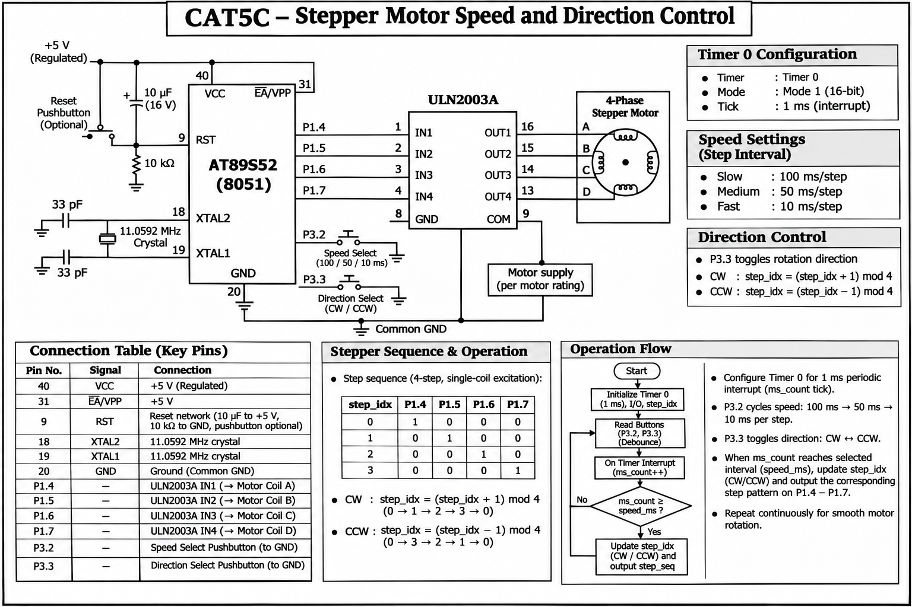

# EXPERIMENT DETAILS

**EXP:** CONTINUOUS ASSESSMENT 5 (CAT5)

**DATE:** 10/08/2026

**NAME OF EXP:** Hardware Timer and Interrupt-Based Timing for LED Fading, Pulse Generation, and Stepper Motor Control

**HARDWARE SETUP / PLATFORM:** AT89S52 (11.0592 MHz) + ULN2003 Motor Driver + 28BYJ-48 Stepper Motor

---

## TASK 5C : 4-Phase Stepper Motor Drive and Direction Controller

### 1. Circuit Diagram

The circuit interfaces 8051 Port 1 lines P1.0–P1.3 to the inputs of a ULN2003 Darlington driver IC.

- **Microcontroller:** AT89S52 (8051 Architecture)
- **Driver IC:** ULN2003A Darlington array
- **Motor:** 28BYJ-48 5V/12V 4-Phase Unipolar Stepper Motor
- **Control Outputs:** P1.0 (IN1), P1.1 (IN2), P1.2 (IN3), P1.3 (IN4)
- **Direction Input:** P2.0 (Active-LOW toggle switch)
- **Power:** +5V DC logic, +5V/+12V motor supply

### 2. Core Logic / Pseudocode / Code Base

**Working Principle:**

The ULN2003 provides high-current open-collector switching with reverse-EMF clamping diodes. The firmware transmits a 4-step excitation sequence (`0x01`, `0x02`, `0x04`, `0x08`). Reversing array traversal inverts motor direction.

### 3. Inference

The ULN2003 successfully isolated the microcontroller from inductive motor kickback while driving coil phases reliably.
