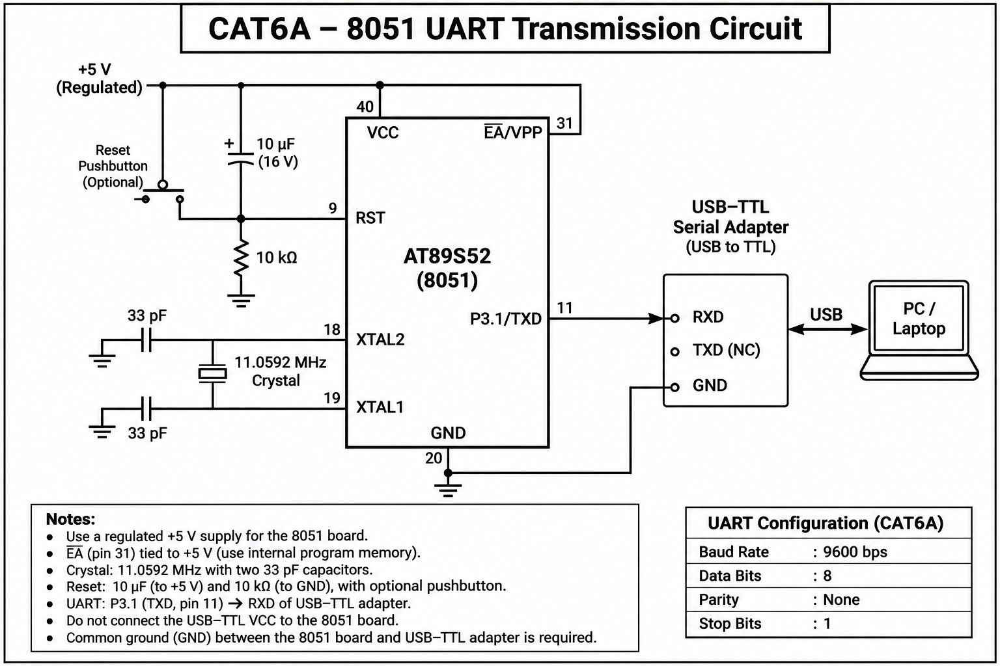

# EXPERIMENT DETAILS

**EXP:** CONTINUOUS ASSESSMENT 6 (CAT6)

**DATE:** 17/08/2026

**NAME OF EXP:** UART Initialization and Character Transmission

**HARDWARE SETUP / PLATFORM:** AT89S52 (11.0592 MHz) + MAX232 / USB-to-UART Bridge + Serial Terminal

---

## TASK 6A : UART Driver Initialization & Serial Data Transmission

### 1. Circuit Diagram

The circuit interfaces pin P3.1 (TXD) of the AT89S52 to a USB-to-TTL serial converter connected to a host PC.

- **Microcontroller:** AT89S52 (8051 Architecture)
- **Clock Frequency:** 11.0592 MHz
- **Transmit Pin (TXD):** P3.1
- **Receive Pin (RXD):** P3.0
- **Baud Rate:** 9600 bps (8-N-1)

### 2. Core Logic / Pseudocode / Code Base

**Working Principle:**

The 8051 UART serial port relies on Timer 1 configured in Mode 2 (8-bit auto-reload) as its baud rate generator. Setting $\text{SMOD}=0$, $f_{\text{osc}}=11.0592\,\text{MHz}$, and $\text{TH1}=0xFD$ yields an exact division result of $9600.00\,\text{bps}$ with $0\%$ error.

### 3. Inference

The calculated auto-reload constant `0xFD` achieved zero baud-rate error at 11.0592 MHz. Strings were received clearly on the host serial monitor.
