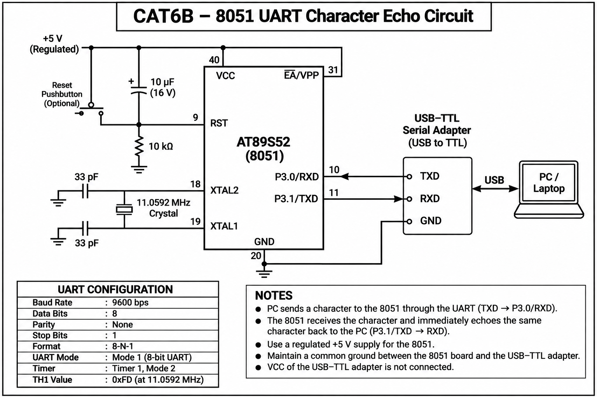

# EXPERIMENT DETAILS

**EXP:** CONTINUOUS ASSESSMENT 6 (CAT6)

**DATE:** 17/08/2026

**NAME OF EXP:** UART Driver and Serial Debugging

**HARDWARE SETUP / PLATFORM:** AT89S52 (11.0592 MHz) + USB-to-UART Module + PC Terminal

---

## TASK 6B : Full-Duplex Serial Echo & Debug Protocol

### 1. Circuit Diagram

The circuit establishes bidirectional communication between AT89S52 serial pins (P3.0/RXD, P3.1/TXD) and a host PC serial terminal.

- **Microcontroller:** AT89S52
- **Transmit Pin (TXD):** P3.1
- **Receive Pin (RXD):** P3.0
- **Status LED:** P1.0
- **Baud Rate:** 9600 bps (8-N-1)

### 2. Core Logic / Pseudocode / Code Base

**Working Principle:**

Full-duplex serial communication enables simultaneous bidirectional data transfer. When a byte is received over P3.0, the hardware sets `RI`. The CPU clears `RI = 0`, reads `SBUF`, and re-transmits the character with an echo prefix.

### 3. Inference

Full-duplex UART communication was verified successfully without buffer overruns.
