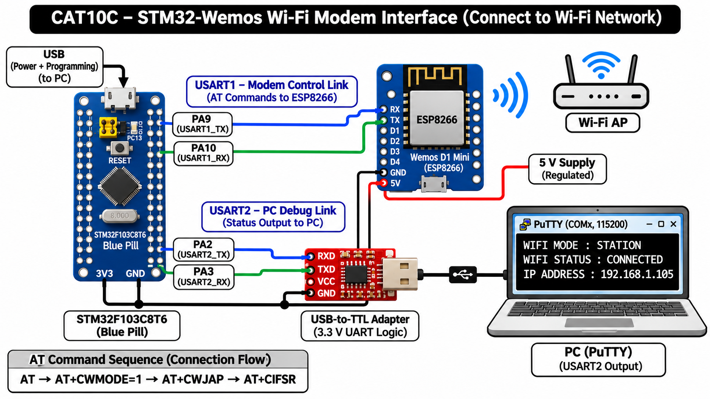

# EXPERIMENT DETAILS

**EXP:** CONTINUOUS ASSESSMENT 10 (CAT10)

**DATE:** 05/10/2026

**NAME OF EXP:** Connect Wemos ESP8266 to Wi-Fi Network

**HARDWARE SETUP / PLATFORM:** STM32F103C8T6 Blue Pill + Wemos D1 Mini (ESP8266) + Dual UART

---

## TASK 10C : Connect Wemos ESP8266 to Wi-Fi Network

### 1. Circuit Diagram

The circuit bridges STM32 USART1 (PA9/PA10) to the ESP8266 hardware serial pins while USART2 (PA2/PA3) routes telemetry to the PC.

- **Master Controller:** STM32F103C8T6 (Blue Pill)
- **Wi-Fi Coprocessor:** Wemos D1 Mini (ESP8266)
- **Modem Link:** USART1 (PA9 to ESP_RX, PA10 to ESP_TX) @ 115200 bps
- **Debug Monitor:** USART2 (PA2=TX, PA3=RX) to PC terminal @ 115200 bps
- **Power Configuration:** Common ground, dedicated 3.3V power rails

### 2. Core Logic / Pseudocode / Code Base

**Working Principle:**

The STM32 acts as an intelligent host controller interfacing with the ESP8266 Wi-Fi modem over Hayes AT commands. The firmware issues AT commands (`AT`, `AT+GMR`, `AT+CWMODE=1`, `AT+CWJAP`), awaits response strings (`OK`, `WIFI CONNECTED`), and relays diagnostic logs to the PC monitor.

### 3. Inference

The dual-UART bridge maintained transparent communication, validating reliable AT command sequencing and successful Wi-Fi station association.
