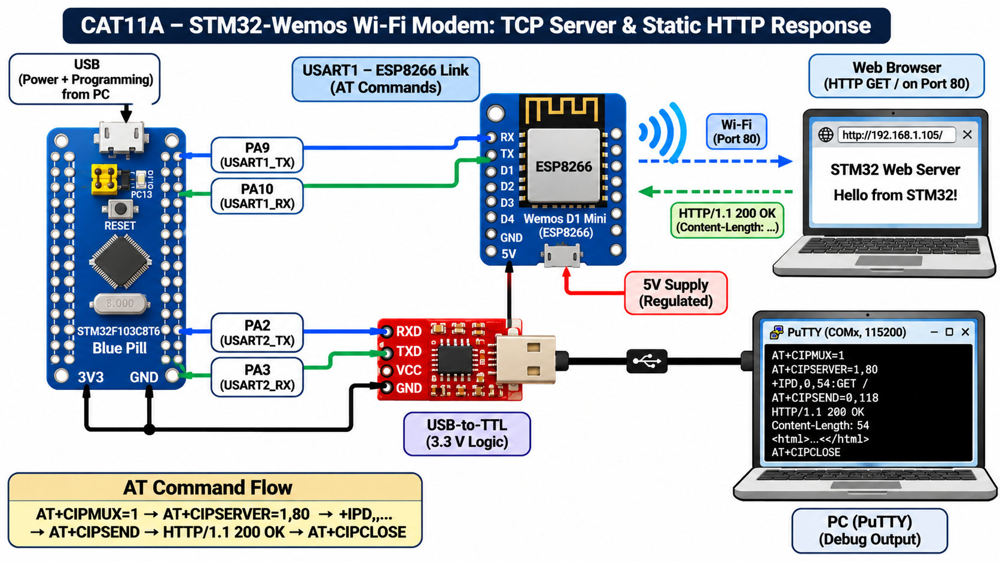

# EXPERIMENT DETAILS

**EXP:** CONTINUOUS ASSESSMENT 11 (CAT11)

**DATE:** 12/10/2026

**NAME OF EXP:** Configure ESP8266 TCP Server & Static HTTP Response

**HARDWARE SETUP / PLATFORM:** STM32F103C8T6 + Wemos ESP8266 + Node-RED Dashboard

---

## TASK 11A : Configure ESP8266 TCP Server & Static HTTP Response

### 1. Circuit Diagram

The circuit connects the STM32 to the ESP8266 module, establishing an embedded HTTP server listening on TCP port 80.

- **Embedded Host:** STM32F103C8T6
- **Wi-Fi Module:** ESP8266 (TCP Server on Port 80)
- **IoT Orchestrator:** Node-RED HTTP Request node polling telemetry

### 2. Core Logic / Pseudocode / Code Base

**Working Principle:**

The STM32 configures multiple connection mode (`AT+CIPMUX=1`) and creates an HTTP server on port 80 (`AT+CIPSERVER=1,80`). When a client connects and sends an HTTP GET request, the ESP8266 emits a `+IPD` packet. The STM32 parses the connection ID and transmits an HTTP 200 OK response with HTML or JSON payloads (`AT+CIPSEND`).

### 3. Inference

The embedded HTTP server successfully handled HTTP client connections, delivering telemetry data to Node-RED dashboards reliably over local Wi-Fi.
