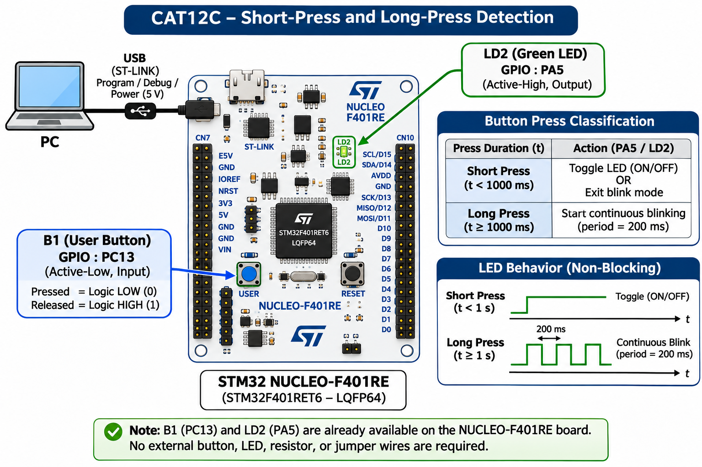

# EXPERIMENT DETAILS

**EXP:** CONTINUOUS ASSESSMENT 12 (CAT12)

**DATE:** 14/10/2026

**NAME OF EXP:** Short-Press and Long-Press Detection

**HARDWARE SETUP / PLATFORM:** STM32 Nucleo-F401RE Development Board + STM32CubeMX + Keil MDK-ARM

---

## TASK 12C : Short-Press and Long-Press Detection

### 1. Circuit Diagram

The experiment utilizes the STM32 Nucleo-64 board with onboard green LED on PA5 and blue tactile user push-button on PC13.

- **Board:** NUCLEO-F401RE
- **Microcontroller:** STM32F401RETx (ARM Cortex-M4 with FPU, 84 MHz)
- **User LED:** PA5 (Green, active HIGH)
- **User Button:** PC13 (Blue button, active LOW)

### 2. Core Logic / Pseudocode / Code Base

**Working Principle:**

The Cortex-M4 architecture on the Nucleo board integrates onboard debuggers and user I/O. The firmware demonstrates register control through STM32Cube HAL functions (`HAL_GPIO_WritePin`, `HAL_GPIO_ReadPin`, `HAL_GPIO_TogglePin`) to implement blinking, latching memory toggling, and press duration classification.

### 3. Inference

The Cortex-M4 Nucleo board was successfully brought up and verified. All switch timing and LED latching algorithms executed with high reliability.
