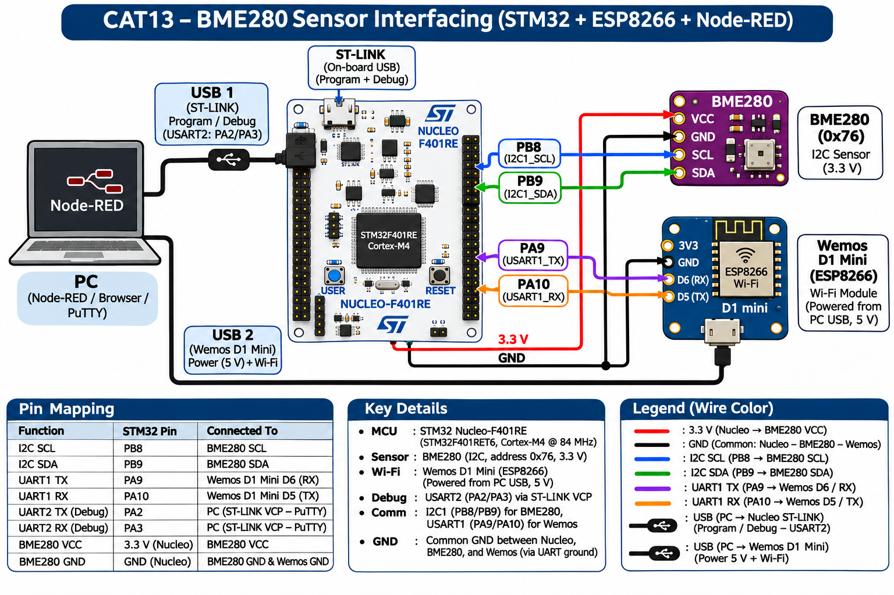

# EXPERIMENT DETAILS

**EXP:** CONTINUOUS ASSESSMENT 13 (CAT13)

**DATE:** 23/10/2026

**NAME OF EXP:** Sensor Interfacing (BME280) – STM32 Debug – ESP8266 Wi-Fi HTTP – Node-RED Analytics

**HARDWARE SETUP / PLATFORM:** STM32F103C8T6 + BME280 (I2C) + Wemos D1 Mini (ESP8266) + Node-RED

---

## TASK 13 : BME280 Sensor Telemetry via HTTP to Node-RED

### 1. Circuit Diagram

The circuit connects the BME280 environmental sensor to the STM32 via I2C (PB6=SCL, PB7=SDA), and communicates with the ESP8266 over USART1.

- **Sensor:** Bosch Sensortec BME280 (I2C Address: 0x76)
- **Microcontroller:** STM32F103C8T6
- **Wi-Fi Coprocessor:** Wemos D1 Mini (ESP8266)
- **Telemetry Protocol:** HTTP GET requests to Node-RED REST API

### 2. Core Logic / Pseudocode / Code Base

**Working Principle:**

The STM32 samples calibrated temperature, relative humidity, and barometric pressure data from the BME280 sensor via I2C. The readings are serialized into an HTTP GET query string transmitted to the ESP8266, which routes the telemetry to a Node-RED endpoint for live dashboard rendering.

### 3. Inference

The I2C sensor pipeline and HTTP telemetry network functioned seamlessly, streaming environmental metrics into Node-RED without packet drop.
