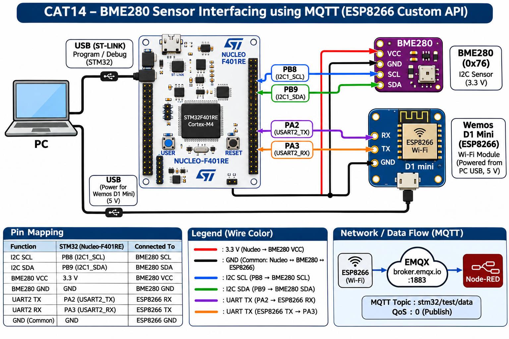

# EXPERIMENT DETAILS

**EXP:** CONTINUOUS ASSESSMENT 14 (CAT14)

**DATE:** 27/10/2026

**NAME OF EXP:** Sensor Interfacing (BME280) – MQTT – Node-RED Analytics

**HARDWARE SETUP / PLATFORM:** STM32F103C8T6 + BME280 + ESP8266 + Mosquitto MQTT Broker + Node-RED

---

## TASK 14 : BME280 Telemetry Publishing via MQTT Protocol

### 1. Circuit Diagram

The circuit connects the BME280 sensor to the STM32 via I2C, while the ESP8266 establishes a lightweight MQTT TCP connection to a broker.

- **Microcontroller:** STM32F103C8T6
- **Sensor:** BME280 (I2C PB6/PB7)
- **Protocol:** MQTT Publish (Topic: `iot/environment/telemetry`)
- **Dashboard:** Node-RED MQTT-In node with UI Gauges

### 2. Core Logic / Pseudocode / Code Base

**Working Principle:**

MQTT is a lightweight publish-subscribe messaging transport optimized for high-latency, resource-constrained IoT links. The STM32 packages sensor readings into compact JSON strings and commands the ESP8266 to publish payloads to the broker. Node-RED subscribes to the topic and visualizes live updates.

### 3. Inference

MQTT demonstrated superior bandwidth efficiency and responsiveness compared to HTTP polling, delivering instantaneous sensor updates to the cloud dashboard.
