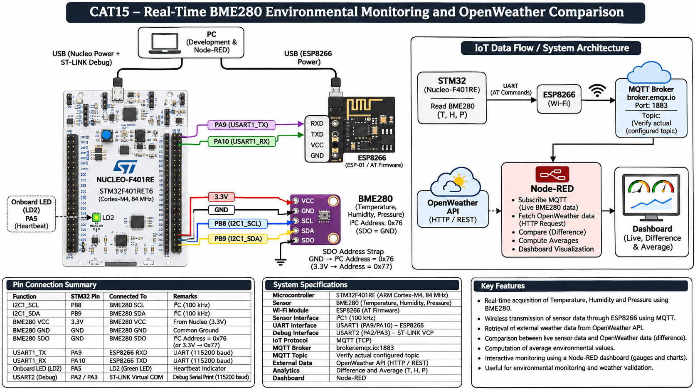

# EXPERIMENT DETAILS

**EXP:** CONTINUOUS ASSESSMENT 15 (CAT15)

**DATE:** 30/10/2026

**NAME OF EXP:** Real-Time Environmental Monitoring, OpenWeather Comparison and Node-RED Analytics

**HARDWARE SETUP / PLATFORM:** STM32 Nucleo-F401RE + BME280 + ESP8266 + Node-RED + OpenWeatherMap API

---

## TASK 15 : Comprehensive Environmental Analytics & Ground-Truth Verification

### 1. Circuit Diagram

The circuit interfaces the BME280 sensor via I2C to the STM32 Nucleo-F401RE, with the ESP8266 handling dual-channel cloud telemetry.

- **Core Processor:** STM32 Nucleo-F401RE (ARM Cortex-M4)
- **Sensor:** Bosch BME280 Environmental Sensor (Temperature, Humidity, Pressure)
- **Wi-Fi Interface:** ESP8266 SoC
- **Cloud API:** OpenWeatherMap Meteorological REST API
- **Analytics Engine:** Node-RED visual flow dashboard

### 2. Core Logic / Pseudocode / Code Base

**Working Principle:**

This capstone IoT system acquires high-precision local environmental measurements from the BME280 sensor, formats them into structured JSON, and dispatches them to a Node-RED orchestration engine. Node-RED concurrently queries the OpenWeatherMap REST API for ground-truth weather data in the local geographic region. The dashboard compares physical sensor readings against atmospheric model predictions, plotting real-time variance gauges and trend lines.

### 3. Inference

The integrated system demonstrated robust sensor fusion, cloud connectivity, and real-time comparative data analytics, successfully completing all FIoT laboratory requirements.
