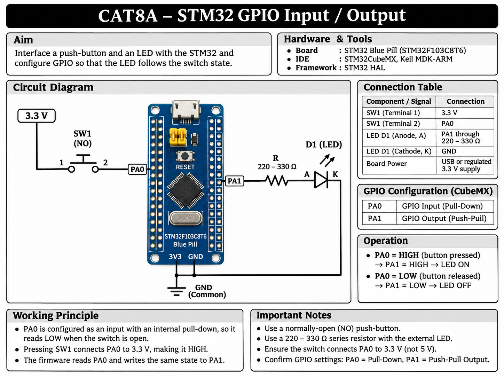

# EXPERIMENT DETAILS

**EXP:** CONTINUOUS ASSESSMENT 8 (CAT8)

**DATE:** 18/09/2026

**NAME OF EXP:** STM32 GPIO Bring-Up and Switch-Controlled LED

**HARDWARE SETUP / PLATFORM:** STM32F103C8T6 Blue Pill + STM32CubeMX + Keil MDK-ARM

---

## TASK 8A : GPIO Digital Output Bring-Up (On-board Blinky)

### 1. Circuit Diagram

The experiment utilizes the onboard user indicator LED connected to GPIO pin PC13 of the STM32F103C8T6 development board.

- **Development Board:** STM32 Blue Pill
- **Microcontroller IC:** STM32F103C8T6 (ARM Cortex-M3, 72 MHz)
- **GPIO Pin:** PC13 (Configured as GPIO_Output, Push-Pull, No-Pull, Low speed)
- **Peripheral:** On-board active-LOW LED with current-limiting resistor
- **Supply Voltage:** 3.3V DC via ST-Link V2 programmer

### 2. Core Logic / Pseudocode / Code Base

**Working Principle:**

The onboard LED is wired in an active-LOW configuration where pin PC13 connects to the cathode of the LED through a current-limiting resistor, and the anode is tied to the 3.3V power rail. Driving PC13 LOW completes the circuit, illuminating the LED. Toggling pin PC13 using `HAL_GPIO_TogglePin(GPIOC, GPIO_PIN_13)` coupled with `HAL_Delay(500)` produces a symmetric 1 Hz flash rate.

**Pseudocode:**

1. Initialize the Hardware Abstraction Layer (`HAL_Init()`).
2. Configure System Clock to 72 MHz using external crystal HSE.
3. Configure GPIO Pin PC13 as output (`GPIO_MODE_OUTPUT_PP`).
4. In main loop:
   - Call `HAL_GPIO_TogglePin(GPIOC, GPIO_PIN_13)`.
   - Call `HAL_Delay(500)` for a 500 ms time interval.

### 3. Inference

The STM32 HAL peripheral clock and GPIO subsystem were successfully initialized. The onboard LED toggled smoothly at 1.0 Hz, verifying functional clock tree configuration and basic output pin control.
