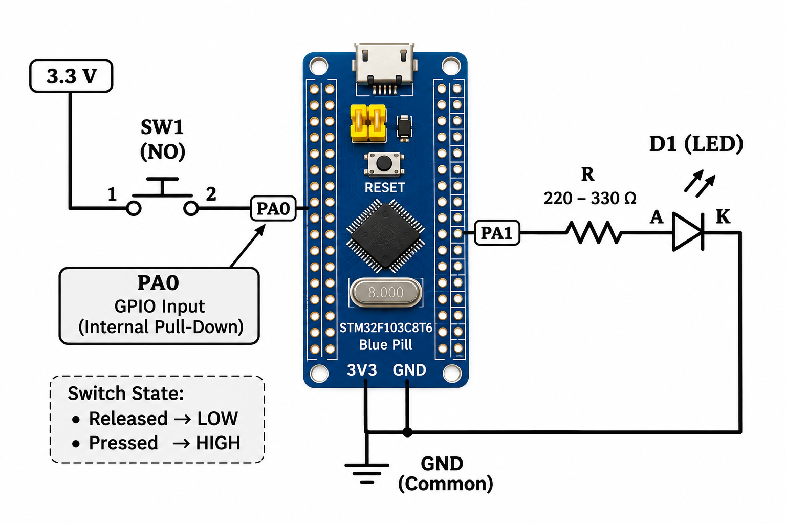

# EXPERIMENT DETAILS

**EXP:** CONTINUOUS ASSESSMENT 8 (CAT8)

**DATE:** 18/09/2026

**NAME OF EXP:** STM32 GPIO Bring-Up and Switch-Controlled LED

**HARDWARE SETUP / PLATFORM:** STM32F103C8T6 Blue Pill + Push Button + External LED

---

## TASK 8B : Event-Based Control with Software Switch Debouncing

### 1. Circuit Diagram

The circuit interfaces an external push-button to PA0 (configured with internal pull-down) and an indicator LED to PA1 via a 330 Ω resistor.

- **Microcontroller:** STM32F103C8T6
- **Input Pin:** PA0 (GPIO_Input, Pull-down)
- **Output Pin:** PA1 (GPIO_Output, Push-pull driving LED)
- **Peripheral:** Tactile push-button and 5mm LED

### 2. Core Logic / Pseudocode / Code Base

**Working Principle:**

Mechanical button contacts vibrate upon closure, causing rapid signal oscillations for 5–20 ms. A non-blocking debouncing routine samples the pin continuously using `HAL_GetTick()`. Only when the pin maintains an unbroken stable state across a 35 ms window is the transition registered as valid, triggering an output toggle on PA1.

**Pseudocode:**

1. Sample PA0 raw state.
2. If raw state differs from previous sample, reset stability timer to `HAL_GetTick()`.
3. If elapsed time exceeds 35 ms and state differs from registered debounced state, commit new state.
4. If newly committed state is pressed (`GPIO_PIN_SET`), toggle LED on PA1.

### 3. Inference

Software debouncing completely eliminated false double-toggling. Exactly one LED state change was registered per physical button depression.
