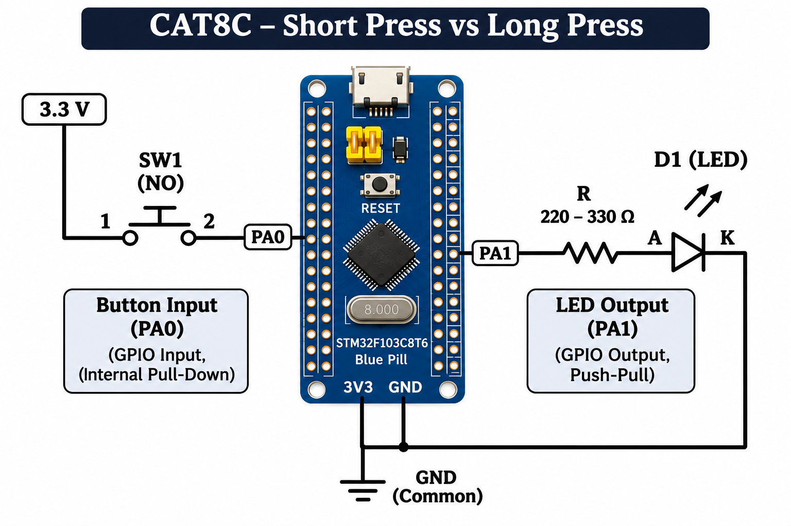

# EXPERIMENT DETAILS

**EXP:** CONTINUOUS ASSESSMENT 8 (CAT8)

**DATE:** 18/09/2026

**NAME OF EXP:** STM32 GPIO Bring-Up and Switch-Controlled LED

**HARDWARE SETUP / PLATFORM:** STM32F103C8T6 Blue Pill + Tactile Switch + LED

---

## TASK 8C : Short-Press vs. Long-Press Duration Classifier

### 1. Circuit Diagram

The circuit uses the debounced switch input on PA0 to control an indicator LED on PA1 based on press duration.

- **Microcontroller:** STM32F103C8T6
- **Input:** PA0 (Push-button with pull-down)
- **Output:** PA1 (LED with 330 Ω series resistor)
- **Classification Threshold:** $1000\,\text{ms}$ ($1.0\,\text{s}$)

### 2. Core Logic / Pseudocode / Code Base

**Working Principle:**

When the button is pressed, the start timestamp is logged (`press_start_tick = HAL_GetTick()`). Upon physical button release, the elapsed duration is calculated: $\Delta t = t_{\text{release}} - t_{\text{press}}$. If $\Delta t < 1000\,\text{ms}$, it is classified as a short press, toggling the LED. If $\Delta t \ge 1000\,\text{ms}$, it is classified as a long press, latching the LED into an autonomous rapid blinking mode.

### 3. Inference

The dual-action classifier reliably distinguished quick taps from deliberate long presses, providing multi-modal control through a single physical button.
