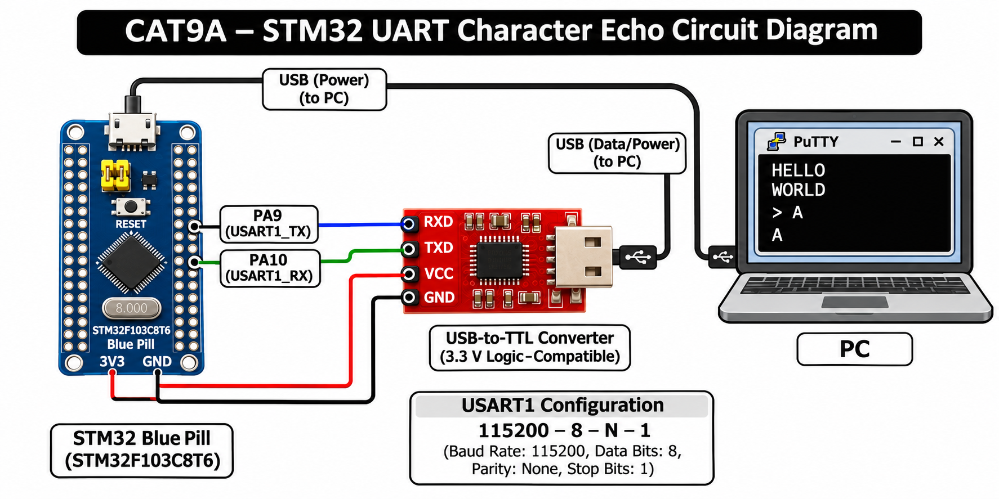

# EXPERIMENT DETAILS

**EXP:** CONTINUOUS ASSESSMENT 9 (CAT9)

**DATE:** 28/09/2026

**NAME OF EXP:** STM32 UART Communication and Character Echo

**HARDWARE SETUP / PLATFORM:** STM32F103C8T6 Blue Pill + USB-to-UART Adapter + Serial Terminal

---

## TASK 9A : STM32 USART1 Character Echo & Banner Transmission

### 1. Circuit Diagram

The circuit connects STM32 USART1 lines (PA9=TX, PA10=RX) to a host PC serial terminal at 115200 baud.

- **Microcontroller:** STM32F103C8T6
- **USART Interface:** USART1 (PA9=TX, PA10=RX)
- **Baud Rate:** 115200 bps, 8 Data Bits, No Parity, 1 Stop Bit (8-N-1)

### 2. Core Logic / Pseudocode / Code Base

**Working Principle:**

Upon hardware reset, the STM32 initializes USART1 via HAL, transmitting a formatted welcome banner string. In the superloop, `HAL_UART_Receive(&huart1, &incoming_char, 1, 50)` polls the hardware receive data register (`DR`). Received bytes are instantly retransmitted back to the host terminal via `HAL_UART_Transmit()`.

### 3. Inference

Full-duplex serial transmission and reception operated flawlessly at 115200 baud with zero character dropped or garbled across the serial bridge.
