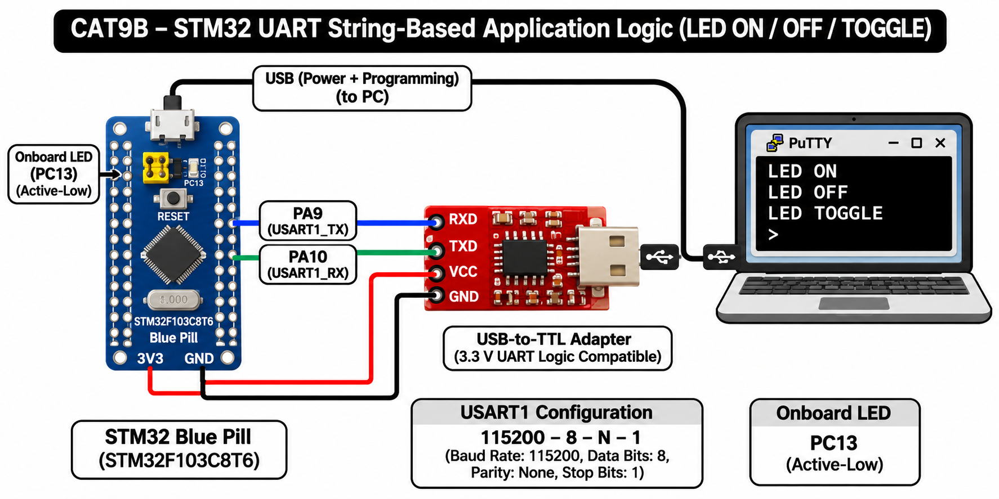

# EXPERIMENT DETAILS

**EXP:** CONTINUOUS ASSESSMENT 9 (CAT9)

**DATE:** 28/09/2026

**NAME OF EXP:** String-Based Application Logic (LED ON / OFF / TOGGLE)

**HARDWARE SETUP / PLATFORM:** STM32F103C8T6 Blue Pill + USB-to-UART Adapter + Serial Terminal

---

## TASK 9B : USART Command Parser for Onboard Peripheral Control

### 1. Circuit Diagram

The circuit connects the USART1 transceiver lines to an external USB-serial adapter to receive ASCII control strings.

- **Microcontroller:** STM32F103C8T6
- **UART Interface:** USART1 (PA9=TX, PA10=RX) @ 115200 bps
- **Controlled Peripheral:** PC13 onboard user LED

### 2. Core Logic / Pseudocode / Code Base

**Working Principle:**

Characters received via USART1 are appended to an accumulation buffer `rx_command_buffer`. Upon receiving a carriage return (`
`) or linefeed (`
`), the string is null-terminated and evaluated using `strcmp()`. If matching `"LED ON"`, `"LED OFF"`, or `"LED TOGGLE"`, the onboard PC13 LED is updated and an acknowledgment prompt is returned to the terminal.

### 3. Inference

The command interpreter successfully parsed incoming string commands and actuated the GPIO output deterministically, demonstrating interactive serial remote control.
